# Reference teardown: sahilgupta.tech

Inspected 11 Nov 2026 in a real browser at 1440×900 and 390×844. Light theme was active because this machine prefers a light color scheme. The stylesheet is `static/css/main.6b927d15.css` (50 KB). The bundle is `static/js/main.18ec6dc6.js`. Screenshots of each section sit in `docs/reference/`.

## Stack

React, built as a single CSS file plus one JS bundle. Motion is **Framer Motion** (bundled: `data-framer-appear-id`, `whileInView`, `layoutId`, springs). Smooth in-page jumps use a react-scroll link (`duration: 600`, `offset: -70`). No GSAP. No Lenis. Google fonts are loaded from a stylesheet link:

`Bricolage Grotesque` variable axes `opsz 12..96`, `wdth 75..100`, `wght 200..800`; `Hanken Grotesk` 400/500/600/700; `JetBrains Mono` 400/500.

Shared tokens on `:root`:

| Token | Value |
| --- | --- |
| `--ease` | `cubic-bezier(0.2, 0.8, 0.2, 1)` |
| `--radius` | 22px |
| `--radius-sm` | 12px |
| `--container` | 1320px |
| `--header-h` | 69px |
| display | Bricolage Grotesque, weight 600, tracking -0.02em, line-height 1.1 |
| body | Hanken Grotesk 16px / 1.6 |
| mono | JetBrains Mono |

Light palette: bg `#f3f2ec`, surface `#fbfaf6`, surface-2 `#e9e8e0`, line `#d9d7cd`, line-2 `#bdbbaf`, text `#0b0c09`, text-2 `#3a3c33`, muted `#5e6055`, accent `#c8f169`, accent-ink `#4f6128`, on-accent `#000`.

Dark palette: bg `#000`, surface `#0b0c09`, surface-2 `#14160f`, line `#22251c`, line-2 `#363a2c`, text `#eeede6`, text-2 `#b4b2a8`, muted `#8a887f`, accent `#c8f169`, accent-ink `#c8f169`.

`prefers-reduced-motion: reduce` forces animation and transition duration to 0.01ms and turns scroll-behavior off. Framer Motion also reads that media query internally.

Section order: nav, hero, glance (bento), projects, about, journey, writing, faq, contact, footer.

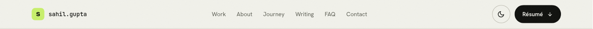
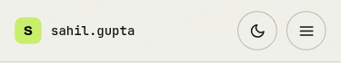

## Theme boot and toggle

An inline script in `index.html` adds class `js`, then sets `data-theme` from `localStorage.theme` or `prefers-color-scheme`, falling back to dark. The toggle button is `.theme-toggle` (44×44, pill, 1px `--line-2`). Hover: border becomes `--text` and the button rotates -20deg over 0.4s `--ease`.

Click writes `localStorage.theme` and, unless reduced motion or `document.startViewTransition` is missing, runs a view transition. The click point is stored as `--vt-x` / `--vt-y`. `::view-transition-new(root)` plays `theme-reveal` for 0.8s with `cubic-bezier(.7, 0, .3, 1)`: a circle clip-path grows from 0 to 150% at that point. Old and new view-transition snapshots use `mix-blend-mode: normal` and `animation: none` on the old one.

## Grain, scroll progress, scroll-to-top

`.grain` is a fixed, pointer-events none SVG fractal-noise overlay, 200px tile, opacity 0.06 (0.09 in light), z-index 150.

`.read-progress` is a 2px accent bar fixed to the top, `transform-origin: 0 50%`, z-index 200. Its `scaleX` is a spring on page `scrollYProgress` (stiffness 200, damping 30, restDelta 0.001).

`.scroll-to-top` is a 48px circle, fixed bottom-right, blurred. Hover fills it with accent. Hidden from 600px down. 44px from 768px down.

## Nav

Sticky, z-index 100, `backdrop-filter: blur(14px)`, background `color-mix(--bg 80%, transparent)`, bottom border `--line`. Inner row is 12px 24px, gap 16px 24px.

Logo: mono 14px / 500, a 30×30 accent mark, radius 8px, display 15px / 800. Hover rotates the mark -8deg and scales 1.06 over 0.4s `--ease`.

Links: 14px, muted, padding 10px 0, gap 26px. An `::after` 1px line scales X from 0 (origin right) to 1 (origin left) in 0.35s `--ease` on hover and `.active`. Color fades in 0.2s.

Actions: theme toggle, then `.btn.btn-solid.nav-resume` (min-height 44, font 14). Buttons are pills, min-height 48, padding 0 22, weight 600. Primary is accent with black text. Solid is text-colored fill. Hover swaps those two. Active press scales to 0.97 over the shared button transition (0.25s).

Below 900px the inline links hide and a 44px burger shows. The sheet is `position: fixed` from the header to the bottom, display type at 34px / 700, tracking -0.03em, each row bordered. The active sheet link uses accent-ink. Below 480px the nav résumé button hides and horizontal padding drops to 16px.

## Hero

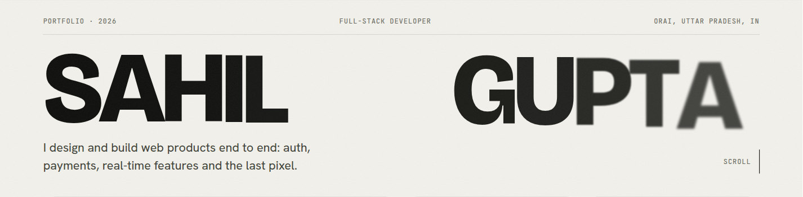
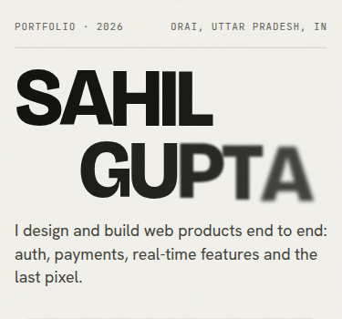

Padding 28px 0 0 (20px on small screens). Meta row is an eyebrow (mono 12px, tracking 0.08em, uppercase) with space-between, bottom border, padding-bottom 14px. Three items: year, role, location. The middle item hides at max-width 600px.

The name is uppercase display, `clamp(2.6rem, 12.6vw, 11.8rem)`, weight 800, tracking -0.045em, line-height 0.84, flex, `justify-content: space-between`, column-gap 0.18em. The last word has `margin-left: auto`. Letters are `inline-block` with a 0.55s `--ease` transition on `font-weight` and `font-stretch`. A final period is accent-ink.

Cursor (pointerType mouse only): `norm = (clientX - wrapLeft) / wrapWidth`, stored in rAF. Each letter `i` of `N` uses `t = (i + 0.5) / N` and `influence = norm < 0 ? 0 : max(0, 1 - abs(norm - t) / 0.17)`. Weight is `round(800 - 600 * influence)` (800 down to 200). Stretch is `round(100 - 25 * influence)%` (100% down to 75%). Pointer leave sets norm to -1, which clears the influence.

Load entrance, per letter, Framer Motion: from `{opacity:0, y:"0.35em", filter:"blur(10px)"}` to settled, duration 0.9s, delay `0.08 + 0.055 * index`, ease `[0.2, 0.8, 0.2, 1]`. The period springs in at delay 0.8, stiffness 400, damping 18.

Scroll of the hero section (`offset: start start → end start`): the name wrap scales 1 → 0.94, translates Y 0% → -8%, and fades 1 → 0.15 across progress 0 → 0.9.

Tagline is `clamp(1.1rem, 1.6vw, 1.35rem)`, max-width 540px. A muted hint sits inline and hides when `hover: none`. The scroll cue is a mono link with a 1×44px track. A child bar runs `hero-cue` for 2.2s, `cubic-bezier(.7,0,.3,1)`, infinite: scaleY 0→1 from the top, then 1→0 from the bottom. The cue hides at 600px. The link smooth-scrolls with duration 600 and offset -70.

## Bento

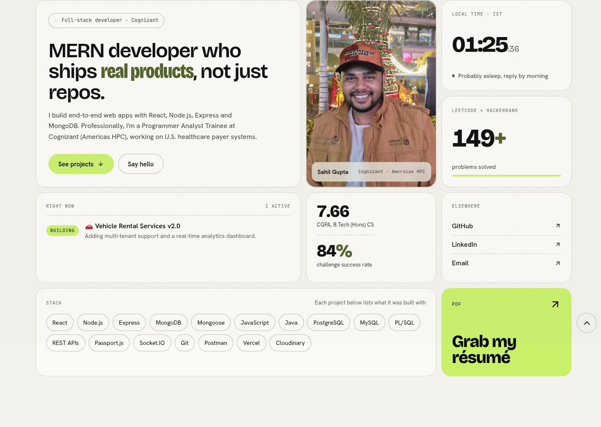
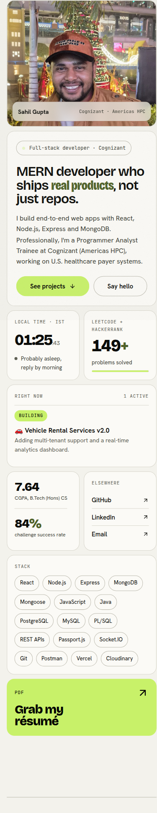

Section padding `0 0 120px` (80px under 600px). Grid: 4 columns, gap 12px, `grid-auto-rows: minmax(210px, auto)`. `.s2` spans 2, `.s3` spans 3, `.r2` spans 2 rows. At 960px it becomes 2 columns and `.s3` spans both. At 600px rows are auto, `.r2` does not span, photo and résumé span 2, and the photo is `order: -1`. At 360px it is one column.

Tile order: intro `s2 r2`, photo `r2`, clock, stat, now `s2`, grade, social, stack `s3`, résumé link.

Tiles enter with Framer `whileInView` once (amount 0.1): from `{opacity:0, y:28}` over 0.6s, delay `0.05 * index`, ease `[0.2, 0.8, 0.2, 1]`.

On bento pointer move, every tile gets `--mx` and `--my` relative to itself. `::before` is a 360px accent radial (14% mix) that fades to 0.4s opacity 1 while the bento is hovered. Tile border shifts to `--line-2` in 0.3s.

Tile chrome: surface, 1px line, radius 22px, padding 24px, gap 16px. Intro padding 30px, gap 28px. Intro h2 is `clamp(2rem, 3.4vw, 3.3rem)`, tracking -0.03em. An `<em>` is accent-ink, stretch 75%, weight 800, not italic. Pill is mono 12px with a 7px pulsing dot (`pulse` 2s ease-in-out, opacity 1 ↔ 0.3).

Photo: min-height 360px, padding 0. Image is absolute cover, `object-position: 50% 22%`, grayscale + contrast 1.05, scale 1.02. Hover, 0.6s filter and 0.8s `--ease` transform: color returns and scale goes to 1.06. Touch (`hover: none`) drops the filter. Caption is a blurred bar, radius 14px, inset 12px from the bottom.

Clock number is 54px (36px on small screens), tabular, weight 800. Seconds are muted 20px weight 400. Mood dot pulses only when the IST hour is 8 or later. A count-up used elsewhere eases with `1 - (1 - t)^3` over 1400ms.

Now rows have a top border and a mono status pill. The lead pill is accent with black text.

Grade tile is two stacked figures. Social links are full-width rows, min-height 44, and the arrow translates `(3px, -3px)` in 0.3s `--ease`.

Chips: 13px, radius pill, border `--line-2`. Hover fills with `--text` and flips the type to `--bg` in 0.2s.

Résumé tile is accent fill, min-height 180px, label 40px / 800. The arrow rotates 45deg in 0.4s `--ease`. Its spotlight `::before` is disabled.

## Projects

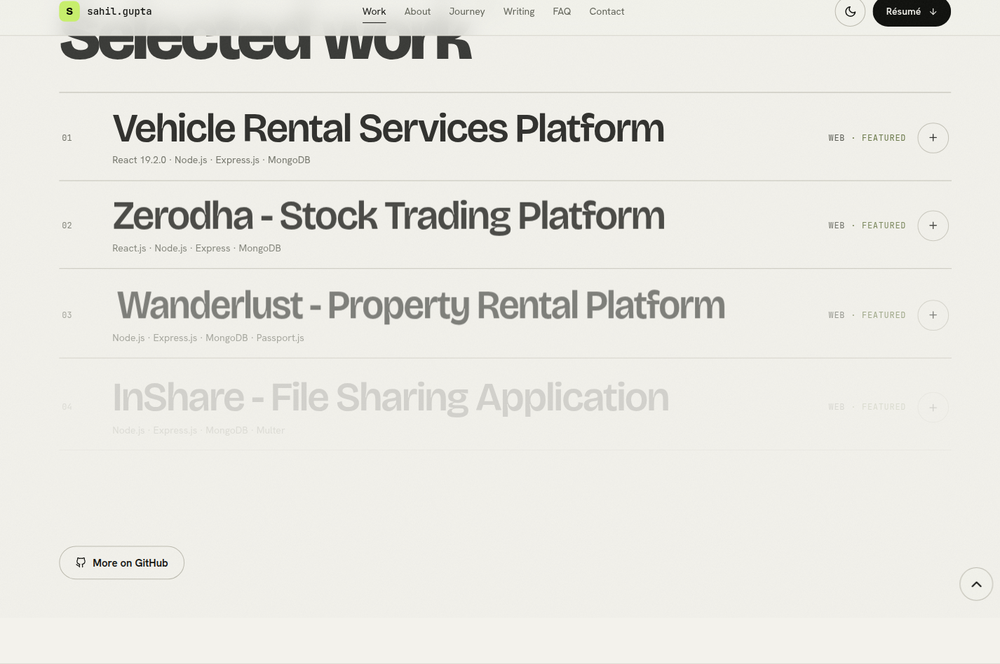
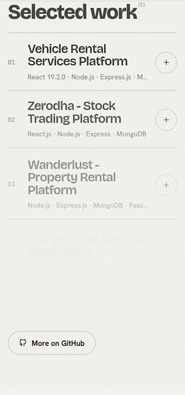

Title is `.display-title`: `clamp(2.6rem, 7vw, 6.4rem)`, weight 800, tracking -0.045em, line-height 0.9. The count is a mono superscript in accent-ink.

Rows: border `--line-2`, head is a grid `56px 1fr 170px 44px`, min-height 112px. While the list is hovered, rows that are neither hovered nor open drop to opacity 0.32 over 0.35s. Title is `clamp(1.6rem, 4vw, 3.6rem)`. Hover stretches it to 82% and shifts it 14px right in 0.45s `--ease`. The plus is a 44px circle that rotates 45deg and fills accent when open.

Panel opens with height 0 → auto and opacity 0 → 1 over 0.5s, ease `[0.2, 0.8, 0.2, 1]`. Inside: a 16/10 cover (flex basis 360px) and body (basis 420px). Cover is a generated panel, not a photo: mono index at `clamp(4rem, 9vw, 8rem)`, stretch 75%, weight 800. Tones cycle accent, inverse, and plain. Chips show 12 tools, then a dashed “+ N more”.

A floating 300×200 card (`z-index 90`, radius 16, shadow) follows the pointer. X/Y are springs (stiffness 260, damping 28, mass 0.6). Rotation is `useTransform` of X velocity from [-1500, 0, 1500] to [-10deg, 0, 10deg]. Opacity/scale animate 0.25s. It hides when `hover: none`. Entering a row with a mouse sets the active project. Leaving the list clears it.

Rows themselves fade up 24px over 0.6s, delay `0.06 * min(index, 5)`, once, amount 0.3.

Under 720px the category column hides and the grid becomes `28px 1fr 44px`.

## About

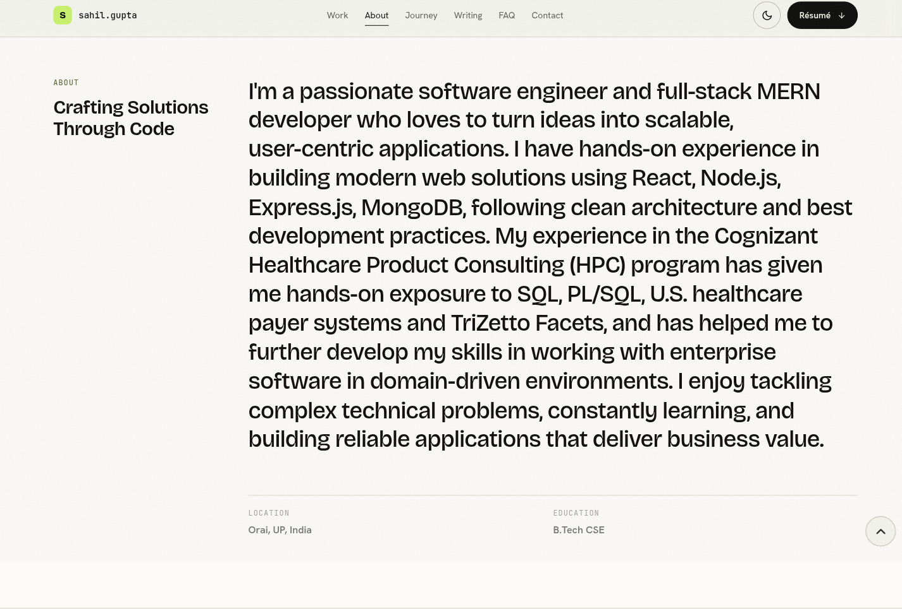
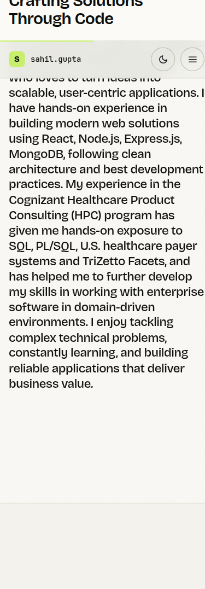

Surface band, borders top and bottom, padding 120px 0 (80px on small screens). Sticky side heading, top `header + 40px`, 30px type. The paragraph is display, `clamp(1.4rem, 2.6vw, 2.3rem)`, weight 500, tracking -0.02em, line-height 1.25, text color (not text-2).

Each word, when scroll-driven animations are supported and motion is allowed, uses `animation-timeline: view()` and `animation-range: cover 10% cover 35%`. Keyframes `about-lit` run linear both: opacity 0.16 → 1.

Facts are a grid under a `--line-2` rule, `minmax(160px, 1fr)`, two columns on small screens. The side heading is static below 600px.

## Journey

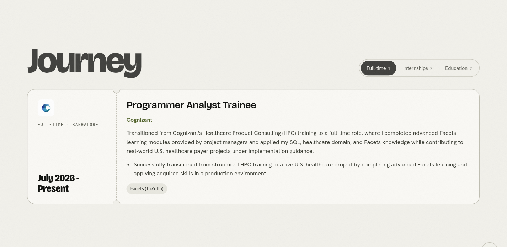
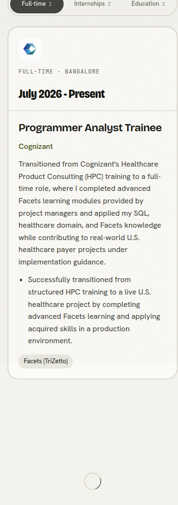

Padding 120px 0. Tabs are the shared `.seg` pill. The active tab has a `.journey-pill` absolutely inset, `layoutId` spring stiffness 420, damping 34. The label sits above it.

Each job is a ticket: surface, radius 22, 1px `--line-2`. A 250px stub with a dashed right border holds a 48px logo tile and a 30px stretched (80%) period. Two 22px circles are clipped at the perforation (`left: 239px`). The main column is 28px type. Tech pills are surface-2, radius 999, 13px. Under 720px the stub stacks, the dashed edge moves to the bottom, and the circles hide.

## Writing

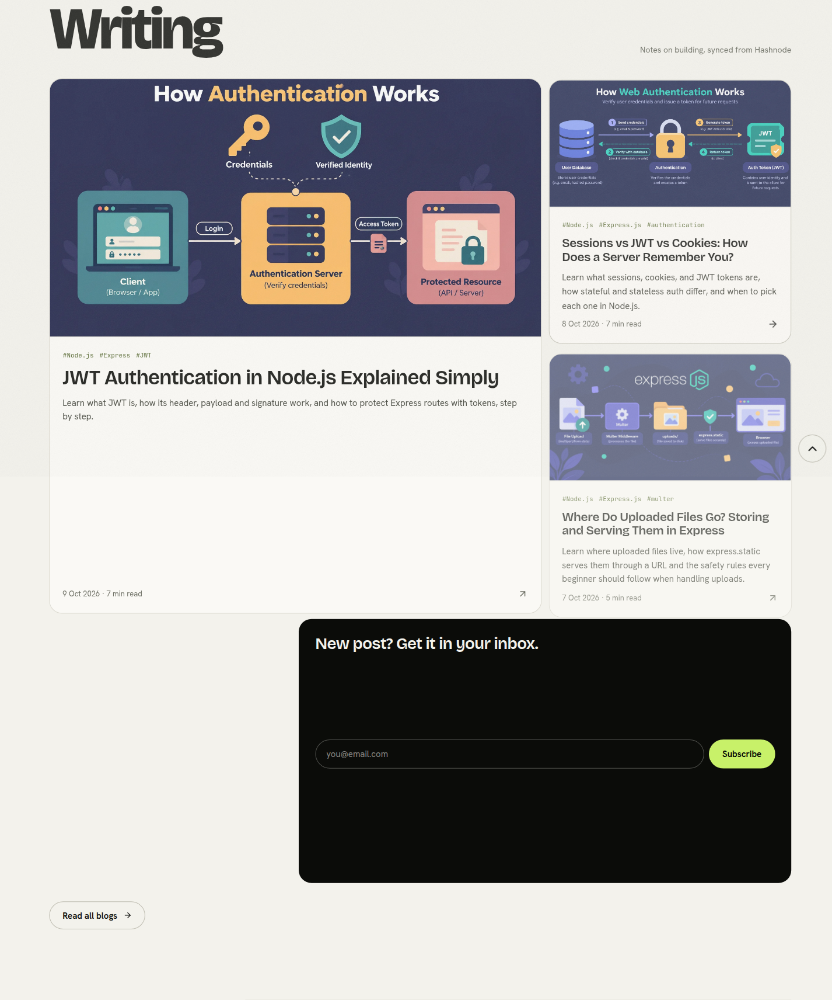
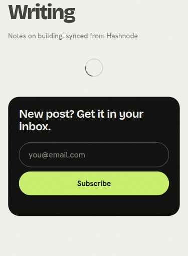

Three columns, gap 12px. The first card spans 2 columns and 2 rows. Cards are surface, radius 22, border fades to `--line-2` in 0.3s. Cover is 1200/630 and scales 1.04 in 0.8s `--ease` on hover. The arrow rotates 45deg in 0.4s. Tags are mono 11px accent-ink. Excerpt clamps to 3 lines. An inverse subscribe card spans 2 columns. At 900px the grid is 2 columns. At 600px it is 1 column, the subscribe card drops the span, and non-feature covers hide.

## FAQ

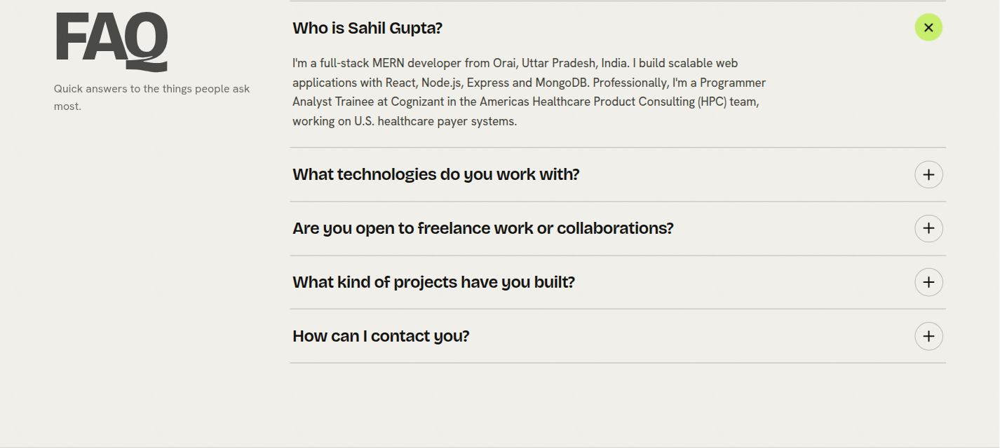
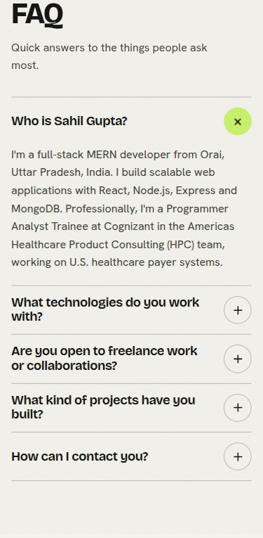

Side intro plus a list. Questions are display `clamp(1.15rem, 2vw, 1.5rem)`, min-height 76px. The plus matches the project plus (40px, rotate 45, accent fill). The answer is a height animation of the same family as the project panel. Answer type is 17px, max-width 760px.

## Contact

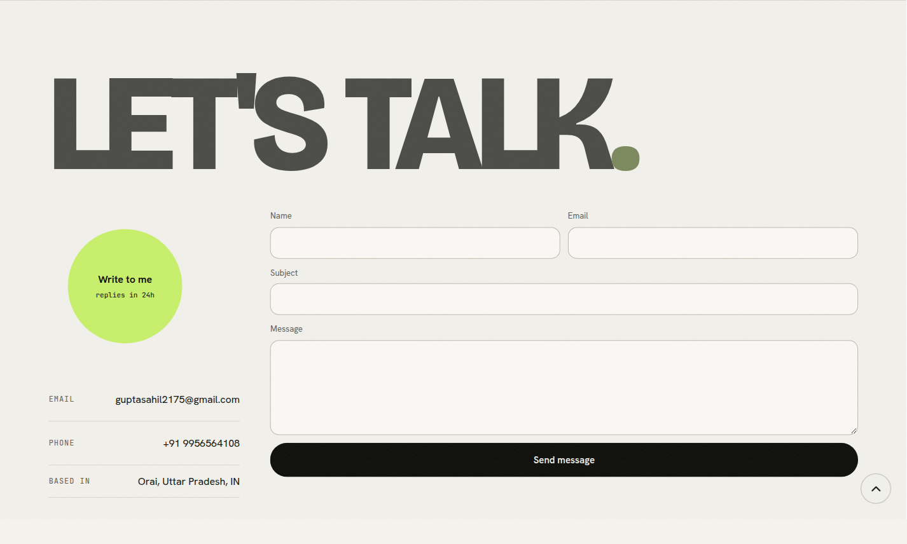
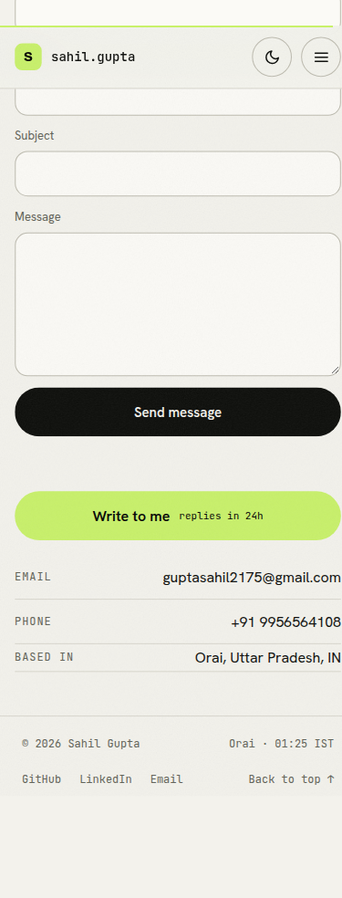

Top border, padding 96px 0 72px. The title is `.talk`: `clamp(3.4rem, 15vw, 15rem)`, weight 800, tracking -0.05em, line-height 0.82, uppercase, nowrap. Hover stretches to 75% and tracking to -0.02em over 0.6s. It enters from y 40, opacity 0, duration 0.8s, once, amount 0.4. The period is accent-ink.

A 240px zone holds a 180px accent circle. Pointer offset from the center is multiplied by 0.3 and sprung (stiffness 220, damping 18). The circle is a mailto link.

Facts are rows with space-between and a bottom border. Hover color is accent-ink. The form is 2 columns: name, email, subject, message, full-width button. Inputs are surface, radius 14, border `--line-2`, focus border `--text` with no extra outline.

## Footer

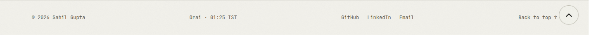
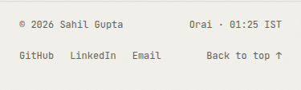

Top border. Inner row is mono 12px, muted, space-between, padding 20px 24px. Links are min-height 44 and turn `--text` on hover in 0.2s. The clock in the middle updates every second.

## Libraries, summarized

| Piece | Library / API | Timing |
| --- | --- | --- |
| Letter entrance, hero scroll, tile reveal, row reveal, panel height, talk entrance, magnet, float card, journey pill, scroll progress | Framer Motion | ease `[0.2, 0.8, 0.2, 1]` unless a spring is named above |
| Theme | View Transitions API | 0.8s `cubic-bezier(.7,0,.3,1)` |
| Name weight / stretch | rAF + CSS transition | 0.55s `--ease` |
| About words | CSS scroll timeline | linear, cover 10%–35% |
| Scroll cue, live dot | CSS keyframes | 2.2s and 2s |
| In-page scroll cue | react-scroll | 600ms, offset -70 |
